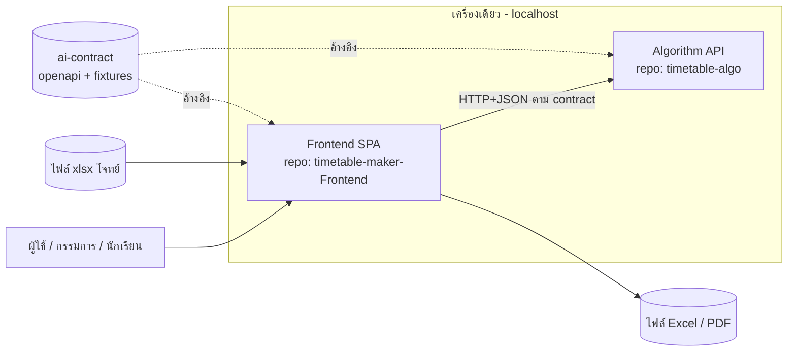
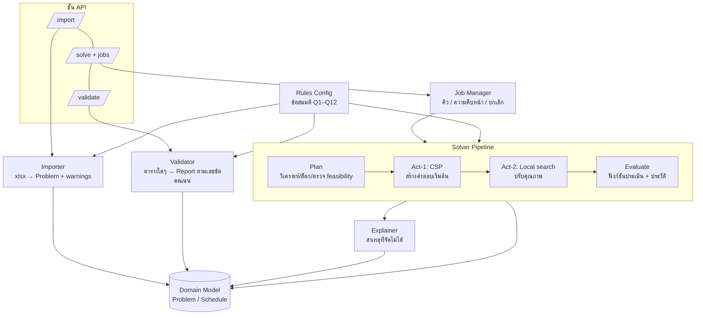
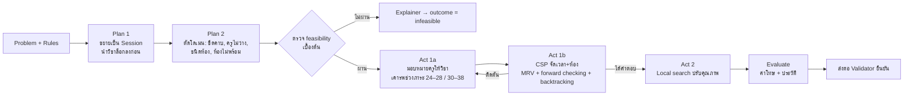
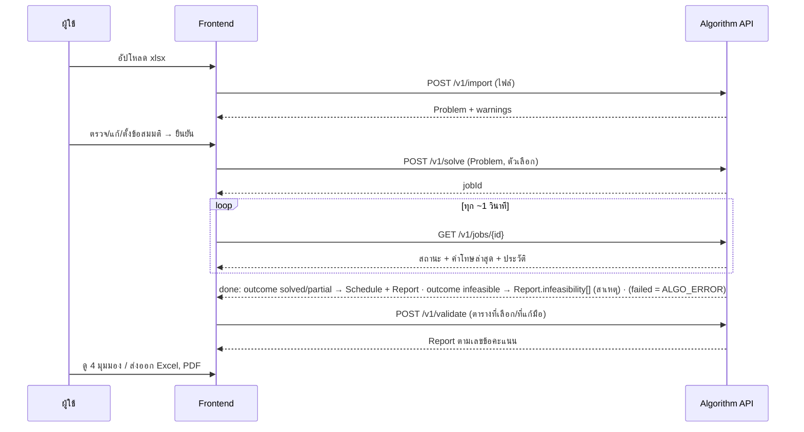
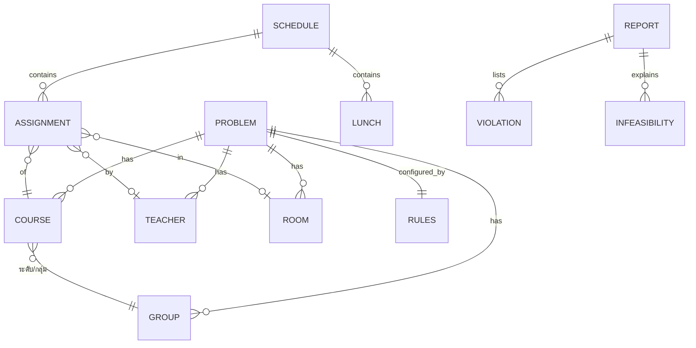
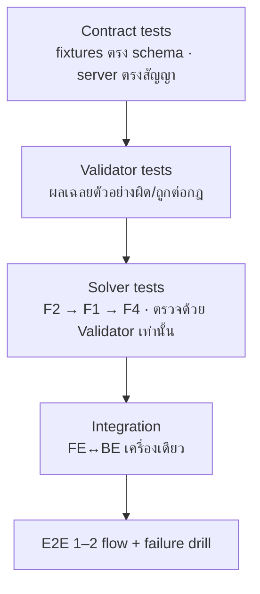

# 04 — System Architecture: ระบบจัดตารางสอน

> อ้างอิง: `01_EXPLANATION` (โจทย์/เหตุผล) · `02_PLAN` (แผนงาน/contract) · `03_FRONTEND_ความต้องการ`
> สถานะ: **ร่างออกแบบ** — ข้อที่เป็น "ข้อเสนอ" ยังไม่ได้พิสูจน์ด้วยโปรแกรม · ข้อที่ขึ้นกับ UNKNOWN ระบุเงื่อนไขไว้
> แผนภาพใช้ Mermaid (เปิดดูได้ใน VS Code/GitHub; ถ้าไม่เรนเดอร์ ให้ดูคำอธิบายใต้แผนภาพ)

**สารบัญ:** §1 เป้าหมาย · §2 ภาพรวมระบบ · §3 โครงภายใน Algorithm · §4 ออกแบบ Solver · §5 โครงภายใน Frontend · §6 ลำดับการทำงาน · §7 โมเดลข้อมูล · §8 Deployment · §9 คุณลักษณะเชิงคุณภาพ · §10 จุดล้มเหลว · §11 ADR · §12 Traceability · §13 ความเสี่ยงของเอกสาร
**เพิ่มเติม (ส่วนที่ขาดไปในฉบับแรก):** **§14 Tech Stack** · **§15 Software Architecture ระดับโค้ด** (โครงโฟลเดอร์ รูปแบบการออกแบบ กฎการพึ่งพา) · **§16 เครื่องมือพัฒนา/คุณภาพ**

---

## 1. เป้าหมายและข้อจำกัดของสถาปัตยกรรม

| มิติ | ข้อกำหนด | ผลต่อการออกแบบ |
|---|---|---|
| ความถูกต้อง | ตารางต้องผ่านกฎ 19 ข้อ และ "ตรวจสอบได้" | มี **Validator อิสระ** แยกจาก Solver |
| ความยืดหยุ่น | โจทย์กรรมการอาจต่างจากตัวอย่าง | กฎ/ข้อสมมติเป็น **ข้อมูล (config)** ไม่ใช่โค้ด · Importer ทนรูปแบบ |
| อธิบายได้ | เกณฑ์ข้อ 4 ต้องอธิบายหลักการ + แสดงหลักฐาน | Solver แบ่งเป็น Plan → Act → Evaluate ที่มองเห็นได้ + บันทึกประวัติค่าโทษ |
| ทำงานร่วมกัน 2 คน 2 เครื่อง | พัฒนาแยก ต่อกันเร็ว | ขอบเขตคั่นด้วย contract เดียว |
| เวลา/ความเรียบง่าย | โปรเจกต์แข่ง ไม่ใช่ระบบ production | ไม่มี DB, ไม่มี auth, ไม่มี microservices, 1 โปรเซส backend |
| วันแข่ง | เครื่องเดียว ออฟไลน์ได้ | ทุกอย่างรันบน `localhost` ไม่พึ่งเน็ต |

**หลักที่ยึด (Pragmatic):** เริ่มจาก monolith ฝั่ง Algorithm 1 โปรเซส + SPA ฝั่ง Frontend — ขึ้นขั้นความซับซ้อนเมื่อมี *หลักฐาน* เท่านั้น (เช่น solver บล็อก request จริง → ใช้ worker แยก)

---

## 2. ภาพรวมระดับระบบ (C4 — Context & Container)



| Container | ความรับผิดชอบ | เจ้าของ | เทคโนโลยี (ข้อเสนอ — เปลี่ยนได้ตาม UNKNOWN) |
|---|---|---|---|
| **Frontend SPA** | UI, มุมมองตาราง, รายงาน, ส่งออก, สาธิต, เก็บสถานะผู้ใช้ในเครื่อง | คุณ | TypeScript + เฟรมเวิร์กเว็บ (React/Vue) · สร้าง type จาก contract |
| **Algorithm API** | อ่านข้อมูลเข้า, โมเดลปัญหา, จัดตาราง, ตรวจตาราง, อธิบายสาเหตุ | เพื่อน | Python + FastAPI (+ Pydantic) · openpyxl อ่าน xlsx |
| **ai-contract** | สัญญากลาง: schema, fixtures, ตัวตรวจ | ร่วม | OpenAPI 3.1 + JSON fixtures |

**ไม่มี:** ฐานข้อมูล, message queue, API gateway, cache, auth (เหตุผลใน §11 ADR)
**รายละเอียดเทคโนโลยีที่เลือกและเหตุผล → §14 · โครงโค้ดและรูปแบบการออกแบบ → §15**

---

## 3. สถาปัตยกรรมภายใน Algorithm API (เพื่อน)



### 3.1 โมดูลและขอบเขต
| โมดูล | หน้าที่ | อินพุต → เอาต์พุต | หลักการสำคัญ |
|---|---|---|---|
| **Importer** | อ่านไฟล์ → `Problem` + `warnings[]` | xlsx → ข้อมูลมาตรฐาน | **จุดเดียวที่รู้รูปแบบ xlsx**; แปลง "จัดอยู่ในวัน…คาบ…" เป็นข้อมูลล็อก; ข้อความแปลไม่ได้ → คำเตือน ไม่ล้ม |
| **Domain Model** | ชนิดข้อมูลกลาง (`Problem`, `Schedule`, `Report`) | — | ใช้ร่วมโดยทุกโมดูล; ตรงกับ contract 1:1 |
| **Rules Config** | ค่าที่ตีความได้หลายแบบ (นับกิจกรรมเป็นชม.ครู, ทฤษฎีรวมกลุ่ม, ช่วงพัก, ขีดคาบ ฯลฯ) | `Problem.rules` | โมดูลอื่นอ่านจากที่นี่ **ห้ามฮาร์ดโค้ดเลข 9/11/24/28/30/38** |
| **Validator** | ตรวจตารางทีละกฎ ผูกเลขข้อ 1.1–2.4 | `Problem` + `Schedule` → `Report` | **เขียนแยกเส้นทางจาก Solver** (ไม่ใช้ฟังก์ชันตรวจร่วมกัน) เพื่อไม่ให้บั๊กเดียวกันทำให้ทั้งคู่ "ผ่านหลอก" |
| **Solver Pipeline** | สร้างและปรับปรุงตาราง | `Problem` → `Schedule` + ประวัติ | ดู §4 |
| **Explainer** | เมื่อจัดไม่ได้ → สาเหตุเป็นข้อๆ | `Problem` (+ ผลบางส่วน) → `infeasibility[]` | ดู §4.5 |
| **Job Manager** | รัน solver เบื้องหลัง, สถานะ, ยกเลิก, เก็บผลชั่วคราว | คำสั่ง → `jobId` | เก็บในหน่วยความจำ + บันทึกผลลงไฟล์ (สำหรับโหมดสำรอง) |
| **API layer** | แปลง HTTP ↔ โมดูล, รูปแบบ error เดียว | | บางที่สุด — ไม่มี logic ธุรกิจ |

**กฎการพึ่งพา:** API → (Importer, Job Manager, Validator) → Solver/Explainer → Domain Model · ห้ามย้อนทิศ · Validator ไม่ import Solver

---

## 4. ออกแบบ Solver (แนวคิด — ไม่ใช่โค้ด)

### 4.1 โมเดลปัญหา
- **หน่วยที่ต้องจัด = "Session"** = (รายวิชา × กลุ่ม) หนึ่งก้อนที่ต้องเป็นช่วงต่อเนื่อง
  - วิชาปฏิบัติ → 1 session ต่อกลุ่ม (2 กลุ่ม = 2 session แยก)
  - วิชาทฤษฎี (รวมกลุ่ม) → 1 session ที่ครอบคลุมทั้ง 2 กลุ่ม
  - วิชาสามัญ → เวลาถูกล็อกแล้ว (ใช้ห้องภายนอก ไม่ชนห้องแผนก)
- **ตัวแปรของ Session:** ครู · ห้อง · วัน · คาบเริ่ม (ความยาว = จำนวนชั่วโมง)
- **ข้อสังเกตเชิงโครงสร้าง (ข้อเสนอ):** กฎ "เริ่มคาบ 1 / ไม่มีคาบว่าง / พักมีเดียว 1 ชม. ที่คาบ 4–6 / ไม่เกินคาบ 9 หรือ 11 / มีเรียนทุกวัน" ทำให้ตารางของกลุ่มในแต่ละวันเป็น **ลำดับก้อนที่ต่อกัน โดยแทรกพักไว้ 1 จุด** → แทนที่จะให้ solver เลือก "คาบเริ่ม" อิสระแล้วค่อยตรวจช่องว่าง ให้เลือก *ลำดับก้อนต่อวัน + ตำแหน่งพัก* จะลดพื้นที่ค้นหามาก (ปวช.1 ใช้ 36 จาก 40 ช่อง — พื้นที่แคบอยู่แล้ว) **เพื่อนต้องตรวจข้อเสนอนี้กับกรณีที่มีวิชาล็อกกลางวัน** เช่น พลศึกษา อังคาร 6–7 และกิจกรรม พฤหัส 6–7
- **ช่วงพักเป็นผลลัพธ์ของ solver** (ไม่ใช่ข้อมูลเข้า) → ส่งออกใน `Schedule` เพื่อให้ FE ไม่ต้องเดา

### 4.2 สายการทำงาน (Plan → Act → Evaluate)


| ขั้น | ทำอะไร | หลักฐานที่ได้ (สำหรับเกณฑ์ข้อ 4) |
|---|---|---|
| Plan 1–2 | ตั้งโจทย์, นำสิ่งที่ล็อกลงก่อน, ตัดตัวเลือกที่เป็นไปไม่ได้ | ตัวเลขก่อน/หลังตัดโดเมน (4.4) |
| Plan 3 | เทียบความต้องการกับความจุ (ชม. vs ช่อง, ภาระครูรวม vs ช่วงที่อนุญาต, ห้อง) | ผลการวิเคราะห์ก่อนจัด (4.4) |
| Act 1a | **มอบหมายครู** — ปัญหาย่อยแบบจับคู่/แบ่งภาระ | เหตุผลการแบ่ง (4.6) |
| Act 1b | CSP: เลือก session ที่โดเมนแคบสุดก่อน (MRV), ตัดโดเมนที่เหลือหลังแต่ละการวาง (forward checking), ย้อนกลับเมื่อติดตัน | ลำดับ/จำนวนการย้อน (4.5, 4.6) |
| Act 2 | Local search (ย้ายก้อน/สลับก้อน/สลับครู/สลับห้อง) ตามฟังก์ชันประเมิน | **ประวัติค่าโทษต่อรอบ** (4.8) |
| Evaluate | คิดค่าโทษ + บันทึกเมตริก | น้ำหนักที่ใช้ (4.7) |

**การจัดระดับข้อจำกัด:** Hard (ห้ามฝ่าฝืน — CSP บังคับ) · Soft (ลดด้วย local search) เช่น ภาระครูเฉลี่ยใกล้กัน, กระจายวันหนักเบา, ลดวิชาปฏิบัติที่ติดคาบเย็น

### 4.3 ฟังก์ชันประเมิน (ต้องนิยามชัด — ข้อ 4.7)
`ค่าโทษ = Σ(Hard ที่ฝ่าฝืน × W_hard) + Σ(Soft × W_soft)` · น้ำหนักอยู่ใน config และแสดงใน `Report.metrics` — ค่า W_hard ต้องใหญ่พอให้ไม่เคยแลกกับ Soft

### 4.4 การทำซ้ำได้และงบเวลา
seed คงที่ · งบเวลาสูงสุดต่อ job (ตั้งจาก UI) · ส่งคำตอบ "ดีที่สุดที่ได้" เมื่อหมดเวลา พร้อมบอกว่าจบเพราะอะไร (ครบ/หมดเวลา/ยกเลิก)

### 4.5 Explainer — สาเหตุที่จัดไม่ได้ (คะแนน 3.3)
วิธีเป็นชั้นๆ (ถูกที่สุดก่อน):
1. **การนับความจุ:** ชม.ที่ต้องการ vs ช่องที่เหลือ ต่อกลุ่ม/ครูรวม/ห้อง
2. **ชนของล็อก:** วิชาที่ถูกล็อกชนกันเอง/ชนเวลาที่ครู-ห้องไม่พร้อม
3. **ช่วงภาระครู:** ภาระรวมของวิชา เทียบผลรวมต่ำสุด–สูงสุดที่ครูทุกคนรับได้
4. **ผ่อนทีละกลุ่มกฎ** (relaxation): ลองปิดกฎทีละกลุ่มแล้วดูว่าจัดได้ไหม → กลุ่มกฎที่ "ปิดแล้วจัดได้" คือผู้ต้องสงสัย (ใช้เมื่อ 1–3 ไม่พบ)
ผลลัพธ์: `infeasibility[]` เรียงตามความน่าจะเป็น แต่ละข้อมีข้อความไทย + ตัวเลขประกอบ + อ้างถึงวิชา/ครู/ห้องที่เกี่ยวข้อง

### 4.6 Validator (แยกอิสระ)
- รับ `Problem` + `Schedule` ใดๆ (จาก solver, จากการแก้ด้วยมือ, จากผลเฉลยตัวอย่าง)
- ตรวจ 1 กฎต่อ 1 ฟังก์ชัน ผูก `rubricId` (1.1…1.12, 2.1…2.4)
- เขียนจากข้อความกฎโดยตรง **ไม่คัดลอกตรรกะจาก solver** · ทดสอบด้วยผลเฉลยตัวอย่าง "ผิดโดยตั้งใจ" ต่อกฎ
- ผลลัพธ์เป็นรายการการฝ่าฝืน + สรุปรายข้อ + ภาระครู

---

## 5. สถาปัตยกรรมภายใน Frontend (คุณ)

```mermaid
flowchart TB
  subgraph UI[ชั้นหน้าจอ]
    P1[นำเข้า/ตรวจข้อมูล] --- P2[ตั้งค่า/สั่งจัด] --- P3[มุมมองตาราง x4 + นักเรียน] --- P4[รายงาน/สาเหตุ] --- P5[ส่งออก/สาธิต]
  end
  UI --> ST[State Store<br/>ร่างโจทย์ · job · ผลตาราง · รายงาน]
  ST --> VM[View-model (ฟังก์ชันบริสุทธิ์)<br/>Schedule → กริดตามกลุ่ม/ครู/ห้อง/วิชา]
  ST --> CL[Algorithm Client<br/>จุดเดียวที่เรียก API · mock | http]
  ST --> PS[Persistence<br/>เก็บในเครื่อง]
  VM --> EXP[Export<br/>Excel / PDF]
  CL --> API[(Algorithm API)]
  CL -. หรือ .-> STUB[(stub อ่าน fixtures)]
```

| ชั้น | หลักการ |
|---|---|
| **Algorithm Client** | ที่เดียวที่รู้ URL/รูปแบบ error · แปลงทุกความล้มเหลวเป็นรหัส (`INVALID_INPUT`…`TIMEOUT`/`NETWORK`) · สลับ stub/จริงด้วยการตั้งค่า |
| **State Store** | แหล่งความจริงฝั่ง FE · หน้าจอไม่เรียก API ตรง |
| **View-model** | ฟังก์ชันบริสุทธิ์ที่แปลง `Schedule` เป็นกริดของแต่ละมุมมอง → ทดสอบได้โดยไม่ต้องมี UI · **ทุกมุมมองมาจากข้อมูลชุดเดียวกัน** (ไม่มีสำเนา) |
| **Persistence** | บันทึกร่างโจทย์ + ผลล่าสุด + ประวัติการจัดในเบราว์เซอร์ → รีเฟรชไม่เสียงาน · ห่อด้วย try/catch (อาจใช้ไม่ได้) |
| **Export** | รับ view-model เดียวกับหน้าจอ → ข้อมูลในไฟล์ = ข้อมูลบนจอ · ฟอนต์ไทยฝังในแอป |
| **ไม่มี logic กฎตารางสอน** | ความถูก/ผิดมาจาก `Report` เท่านั้น |

---

## 6. ลำดับการทำงานหลัก



**ทางเลือกที่ไม่ใช้:** WebSocket/SSE (polling เรียบง่ายกว่าและ debug ง่ายกว่า ไม่ต้องการ push จริง) · ทบทวนเมื่อพบว่า polling ทำให้กราฟไม่ลื่น

---

## 7. โมเดลข้อมูลกลาง (ระดับแนวคิด — รายละเอียดฟิลด์อยู่ใน `02_PLAN §2`)



- `Problem`, `Schedule`, `Report` เป็น **ข้อมูลล้วน (JSON)** — ไม่มีพฤติกรรม
- `Schedule` มี `lunch[]` (กลุ่ม, วัน, คาบพัก) และ `assignments[]` ที่มี `groupIds[]` เป็นส่วนหนึ่งของผลลัพธ์ — ไม่ปล่อยให้ FE อนุมาน (ฟิลด์เต็มที่ `02 §2.2`)
- ไม่มีฐานข้อมูล: โจทย์/ผลเก็บเป็นไฟล์ JSON (บันทึก-เปิดใหม่ได้ = FR-08)

---

## 8. การปรับใช้ (Deployment)

| โหมด | ใช้เมื่อ | รูปแบบ |
|---|---|---|
| **A. พัฒนา (2 เครื่อง)** | ระหว่างทำ | แต่ละคนรันของตัวเอง · FE ใช้ stub หรือเรียก algorithm ของเพื่อนผ่านเครือข่าย (ตั้ง bind/IP/firewall ตาม `reference/AI_COMPETITION_FE_ALGO_ARCHITECTURE.md` §7) |
| **B. วันแข่ง (แนะนำ) เครื่องเดียว 2 โปรเซส** | ค่าเริ่มต้น | FE (พอร์ต 5173) + Algorithm (พอร์ต 8000) · เรียกแบบ same-origin ผ่าน dev proxy |
| **C. วันแข่ง ทางเลือกเรียบสุด: 1 โปรเซส** | ถ้าต้องการลดจุดล้ม | build FE เป็นไฟล์ static แล้วให้ Algorithm API เสิร์ฟ → พอร์ตเดียว ไม่มี CORS/proxy/IP · ต้องตกลงขั้นตอน "คัดลอกไฟล์ build" ระหว่าง 2 repo |

ข้อกำหนดวันแข่ง: สคริปต์เริ่ม 1 คำสั่ง · pin เวอร์ชัน · dependency และฟอนต์ติดตั้งไว้ในเครื่อง (ออฟไลน์) · `GET /health` · ผลตัวอย่างที่บันทึกไว้เป็นโหมดสำรอง

**ความปลอดภัย (ขั้นต่ำ ตาม Safety floor):** ข้อมูลเป็นข้อมูลจำลอง · listen เฉพาะ `127.0.0.1` เว้นแต่จำเป็น (FQ4) · ตรวจชนิด/ขนาดไฟล์อัปโหลด · validate input ฝั่ง API ทุกครั้ง · ไม่มี secret ใน repo

---

## 9. คุณลักษณะเชิงคุณภาพ → กลไกในสถาปัตยกรรม

| คุณลักษณะ | กลไก |
|---|---|
| ถูกต้อง/ตรวจสอบได้ | Validator แยกอิสระ · รายงานผูกเลขข้อ · ผลเฉลยตัวอย่างต่อกฎ |
| ยืดหยุ่นต่อโจทย์เปลี่ยน | Rules Config · Importer ทนรูปแบบ · ไม่ฮาร์ดโค้ดเลขจากโจทย์ · fixtures F4 |
| อธิบายได้ | pipeline Plan→Act→Evaluate · ประวัติค่าโทษ · Explainer |
| ทำซ้ำได้ | seed · บันทึกตัวเลือกกับผลทุกครั้ง |
| ทนความล้มเหลว | รหัส error เดียว · FE ครอบทุกกรณี · โหมดสำรอง · job ยกเลิกได้ · หมดเวลาแล้วคืนผลที่ดีที่สุด |
| สังเกตการณ์ได้ | `requestId` ทุกคำขอ · log ของ job (เริ่ม/จบ/ค่าโทษ/เวลา) · `GET /health` มีเวอร์ชัน |
| แยกงานได้ | ขอบเขตโมดูลชัด · contract เดียว · stub ฝั่ง FE · validator ให้ FE ตรวจได้โดยไม่ต้องรอ solver |

---

## 10. จุดล้มเหลวและการรับมือ

| จุด | ผลกระทบ | รับมือ |
|---|---|---|
| ไฟล์ xlsx โครงต่างจากตัวอย่าง | import พัง/ได้ข้อมูลผิด | คำเตือนต่อเซลล์ · หน้าแก้ข้อมูล · ไม่ crash |
| ข้อความ "จัดอยู่ใน…" รูปแบบใหม่ | ล็อกวิชาผิด | แสดงเป็นคำเตือน + ให้ผู้ใช้กรอกล็อกด้วยมือ |
| Solver ติดตัน/ช้า | ไม่ได้ตาราง | ตัดโดเมนก่อน · ย้อนไปมอบหมายครูใหม่ · งบเวลา · คืนผลดีสุด + บอกสาเหตุหยุด |
| จัดไม่ได้จริง | | Explainer → รายงานสาเหตุ (เป็นคะแนน) |
| Algorithm ล่มกลางงาน | | FE แจ้ง + เปิดผลที่บันทึกไว้ (ติดป้ายโหมดสำรอง) |
| Export ภาษาไทยเพี้ยน | | ฟอนต์ฝังในแอป · ทดสอบบนเครื่องอื่นตั้งแต่ต้น · แผนสำรอง: ให้ Algorithm สร้างไฟล์แทน |
| contract ไม่ตรงกัน 2 ฝั่ง | ต่อกันไม่ได้ | เวอร์ชันแสดงใน `/health` และใน FE · ตัวตรวจ contract ก่อน merge |

---

## 11. การตัดสินใจสถาปัตยกรรม (ADR ย่อ)

| ADR | ตัดสินใจ | เหตุผล | เงื่อนไขทบทวน |
|---|---|---|---|
| 01 | แยก FE กับ Algorithm เป็น 2 โปรเซส สื่อสารด้วย HTTP+JSON | ตรงเงื่อนไข 2 คน 2 repo, เครื่องมือเยอะ, debug ง่าย | ถ้า FE เป็น UI แบบ Python (Streamlit/Gradio) → รวมเป็นโปรเซสเดียวได้ (FQ6) |
| 02 | Backend เป็น monolith 1 โปรเซส (ไม่ microservices/gateway) | ไม่มีปัญหาที่การแยกจะแก้ | solver บล็อก API จนใช้ไม่ได้ → แยก worker |
| 03 | **ไม่มีฐานข้อมูล** เก็บเป็นไฟล์ JSON/หน่วยความจำ/ที่เก็บในเบราว์เซอร์ | ข้อมูลเล็ก ผู้ใช้ไม่กี่คน อายุสั้น | ต้องหลายผู้ใช้พร้อมกัน/เก็บถาวร |
| 04 | งาน solve เป็น **async job + polling** (สถานะ/outcome ตาม `02 §2.3`) | เวลาไม่แน่นอน · ได้ประวัติค่าโทษสำหรับกราฟ | ต้อง push จริง → SSE |
| 05 | **Validator แยกอิสระจาก Solver** | พิสูจน์ต่อกรรมการ + กันบั๊กซ้ำสองที่ | — |
| 06 | Importer อยู่ฝั่ง Algorithm | ความหมายของข้อมูล (ข้อความล็อก) อยู่จุดเดียว | ถ้าโจทย์ไม่ใช่ xlsx → เพิ่มตัวอ่านใหม่ที่ Importer เท่านั้น |
| 07 | Export Excel/PDF อยู่ฝั่ง FE จาก view-model | ข้อมูลในไฟล์ตรงกับหน้าจอ · Algorithm โฟกัสที่คำนวณ | ฟอนต์ไทยใน PDF มีปัญหา → ย้ายไปสร้างฝั่ง Algorithm |
| 08 | กฎ/ข้อสมมติเป็นข้อมูล (`Problem.rules`) | โจทย์กรรมการอาจเปลี่ยน, Q1–Q12 ยังไม่ยืนยัน | — |
| 09 | เทคนิค AI: CSP (+ ย้อนกลับ) สร้างคำตอบเริ่มต้น → Local search ปรับคุณภาพ | อธิบายได้ ตรงเกณฑ์ข้อ 4 · CP-SAT เป็นตัวเลือกสำรองถ้าอนุญาต (G1) | กติกาห้ามไลบรารี/พบว่าช้าเกิน |
| 10 | วันแข่งรันเครื่องเดียว localhost | ตัดความเสี่ยง Wi-Fi/firewall | กติกาบังคับ 2 เครื่อง (G2) |

---

## 12. การสืบย้อนกลับ (Traceability — ย่อ)

| ความต้องการ | ส่วนของสถาปัตยกรรม |
|---|---|
| ข้อ 1.x ถูกต้อง (40) | Solver (Hard) + Validator (§4.6) |
| 2.x ครบถ้วน (15) | Domain Model `Schedule` + View-model (§5) |
| 3.1 นำเข้า | Importer + หน้าตรวจข้อมูล (§3, §5) |
| 3.2 จัดอัตโนมัติ | Solver Pipeline + Job Manager (§4) |
| 3.3 สาเหตุ | Explainer (§4.5) |
| 3.4 มุมมอง | View-model (§5) |
| 3.5 ส่งออก | Export (§5, ADR-07) |
| 4.x AI | Pipeline Plan/Act/Evaluate + ประวัติ (§4.2–4.3) |
| 5.x นำเสนอ | หน้าสาธิต + โหมดสำรอง (§5, §8) |

---

## 13. สิ่งที่ยังไม่ได้ตัดสิน / ความเสี่ยงของเอกสารนี้
- **ข้อเสนอ §4.1** (แทนตัวแปรด้วย "ลำดับก้อนต่อวัน + ตำแหน่งพัก") ยังไม่ได้ทดสอบ — เพื่อนควรลองกับ F1/F2 ก่อนตัดสินใจ
- เทคโนโลยีเฉพาะ (React/Vue, FastAPI) **ขึ้นกับ** G5/FQ6 ที่ยังไม่ตอบ
- ADR-09 และ ADR-10 ขึ้นกับกติกาแข่ง G1/G2
- ไม่ได้ประเมินประสิทธิภาพ solver จริง — งบเวลา/ขนาดโจทย์ที่ทำได้ต้องวัดเมื่อมีต้นแบบ
- ฟิลด์ใน contract อยู่ที่ `02_PLAN §2` (แหล่งความจริง — `lunch[]` และ `groupIds[]` ใส่แล้วใน §2.2, สถานะ job ใน §2.3) · ต้องตรวจให้ตรงกับ repo `ai-contract` อีกครั้งเมื่อ freeze v1.0.0

---

## 14. Tech Stack

> หลักเลือก (EPEF §5 แบบย่อ — `reference/ENTERPRISE_PROJECT_ENGINEERING_FRAMEWORK.md`): ตอบโจทย์ → **ทีมถนัด** → ความเสี่ยง/ความสุกงอม → ใช้งานง่ายตอนแข่ง (ออฟไลน์, ติดตั้งน้อย) → ย้อนกลับง่าย · ใช้ "boring technology" ได้ innovation token ไม่เกิน 1 ตัว
> **ยังไม่ทราบ:** ภาษา/เฟรมเวิร์กที่ถนัด (G5/FQ6) และกติกาเรื่องไลบรารี (G1) → ด้านล่างจึงเป็น **Profile แนะนำ + เงื่อนไขที่ทำให้เปลี่ยน**
> เลขเวอร์ชัน: ให้ติดตั้งรุ่นเสถียรล่าสุด ณ วันตั้งโปรเจกต์แล้ว **pin** ใน lockfile/requirements (ผมไม่ได้ตรวจเวอร์ชันล่าสุดให้) · เครื่องของคุณมี Python 3.10.0 และ Node 24.14.0 (ตรวจจากเครื่องนี้) — ตรวจเครื่องเพื่อนด้วย

### 14.0 สรุป Tech Stack (ดูตารางเต็มและเหตุผลใน 14.1)

| ส่วน | เลือก |
|---|---|
| Frontend | TypeScript · React + Vite · React Router · TanStack Query · Zustand (เมื่อจำเป็น) · Tailwind CSS · Recharts · Zod |
| Export | ExcelJS (Excel) · print-to-PDF ของเบราว์เซอร์ (PDF) · pdfmake เป็นทางเลือกหลังทำ spike S1 |
| Backend / Algorithm | Python 3.10+ · FastAPI + Uvicorn · Pydantic · openpyxl · solver เขียนเอง (CSP + local search) |
| งานเบื้องหลัง | `multiprocessing` (1 job = 1 โปรเซสลูก) |
| ข้อมูล | ไม่มี DB — ไฟล์ JSON + หน่วยความจำ + ที่เก็บในเบราว์เซอร์ |
| Contract | OpenAPI 3.1 + jsonschema (repo `ai-contract`) · openapi-typescript สร้าง type ฝั่ง FE |
| ทดสอบ | FE: Vitest + Testing Library + Playwright · BE: pytest |
| คุณภาพ | ESLint + Prettier · Ruff · gitleaks · Git + GitHub |
| วันแข่ง | เครื่องเดียว localhost · ออฟไลน์ · ฟอนต์ไทยบรรจุในแอป |
| ตัวเลือกที่ขึ้นกับกติกา | OR-Tools CP-SAT (ถ้า G1 อนุญาต) · Profile B Python ล้วน (ถ้าไม่ถนัดเว็บ) |

### 14.1 Profile A (แนะนำ): เว็บ SPA + Python API
| ชั้น | เลือก | เหตุผล | ทางเลือก / เปลี่ยนเมื่อ |
|---|---|---|---|
| **FE ภาษา** | TypeScript (strict) | ชนิดข้อมูลจับผิดแทนคน/โมเดลเล็ก · สร้าง type จาก contract | JavaScript ถ้าทีมไม่ถนัด (เสียการตรวจชนิด) |
| **FE framework** | React + Vite | เครื่องมือ/ตัวอย่างเยอะ ที่สุด (โมเดล AI รู้จักดี) · build เป็น static ได้ (โหมด C) | Vue ถ้าทีมถนัด |
| **Routing** | React Router | มาตรฐาน | — |
| **ดึงข้อมูล/โพล** | TanStack Query | จัดการ loading/error/polling ให้ (job status ทุก ~1 วิ) | เรียกเอง ถ้าอยากลดไลบรารี |
| **สถานะ** | state ใน component → Zustand เมื่อต้องแชร์ | เบา อ่านง่าย | React Context ถ้าน้อย |
| **ตรวจข้อมูล** | Zod (ข้อมูลที่ไม่มาจาก contract: ฟอร์ม/ไฟล์ที่เก็บไว้) | ชนิด + ตรวจในที่เดียว | — |
| **Type จาก contract** | openapi-typescript | ชนิดตรงสัญญา 100% | เขียนมือ (ห้าม — drift) |
| **ตาราง/กริด** | คอมโพเนนต์ตารางเขียนเอง (CSS Grid) | กริดตารางเรียนมีรูปแบบเฉพาะ (คาบคร่อม, พัก) ไลบรารีตารางทั่วไปไม่ตรง | — |
| **กราฟ** | Recharts | กราฟเส้นค่าโทษต่อรอบ (ข้อ 4.8) ใช้ง่าย | Chart.js |
| **Styling** | Tailwind CSS + token | เร็ว · บังคับใช้ token ได้ (ดู `AI_WEB_RULES_10B`) | CSS Modules |
| **ฟอนต์ไทย** | ฟอนต์ไทยฟรีสิทธิ์ใช้งานเสรี (เช่น Sarabun/Noto Sans Thai) **บรรจุในแอป** (ไม่โหลดจากเน็ต) | วันแข่งออฟไลน์ · ใช้ใน PDF ด้วย | — |
| **Export Excel** | ExcelJS | สร้าง .xlsx หลายแผ่น/จัดรูปแบบ ในเบราว์เซอร์ | SheetJS |
| **Export PDF** | **เริ่มด้วย print stylesheet + "บันทึกเป็น PDF" ของเบราว์เซอร์** (ภาษาไทยเรนเดอร์โดยเบราว์เซอร์ จึงเสี่ยงฟอนต์เพี้ยนน้อยสุด) → ถ้าต้องการปุ่มดาวน์โหลดตรงให้ทำสเปก S1 (spike) ลอง pdfmake + ฟอนต์ไทยฝัง | ไทยเป็นจุดเสี่ยงสุดของ export | ให้ Algorithm สร้าง PDF ด้วย ReportLab ถ้า S1 ล้ม |
| **ทดสอบ FE** | Vitest + Testing Library (unit/view-model) · Playwright (e2e 1–2 flow) | เร็ว/มาตรฐาน | — |
| **Mock ฝั่ง FE** | stub อ่าน fixtures ของ contract · (ทางเลือก) Prism/MSW | | |
| **BE ภาษา/เฟรมเวิร์ก** | Python 3.10+ + FastAPI + Uvicorn | งานอัลกอริทึมเขียนเร็ว/อ่านง่าย · FastAPI สร้าง OpenAPI/Swagger ให้ · debug ง่าย | Node/Express ถ้าเพื่อนถนัด JS (แต่ solver หนักๆ เขียนใน Python สบายกว่า) |
| **โมเดลข้อมูล BE** | Pydantic (ตรงกับ contract) + dataclass ภายใน solver | ตรวจ input อัตโนมัติ | — |
| **อ่าน xlsx** | openpyxl | อ่านชีต/เซลล์ที่รวมกัน (merged) ได้ — ไฟล์ตัวอย่างมี merged cells | pandas (หนักเกินจำเป็น) |
| **Solver** | โค้ดเขียนเอง (Python ล้วน): CSP + local search | อธิบายได้ (ข้อ 4) · ไม่ผูกไลบรารี | **OR-Tools CP-SAT** เป็นตัวอ้างอิง/สำรอง *เฉพาะถ้า G1 อนุญาต* (ใช้ตรวจว่ามีคำตอบ/ตรวจ infeasible) |
| **งานเบื้องหลัง** | `multiprocessing`/`ProcessPoolExecutor` (1 job = 1 โปรเซสลูก) + ส่งความคืบหน้าผ่าน queue | งานค้นหาเป็น CPU-bound — เธรดจะติด GIL และทำให้ API ช้า | เธรดธรรมดาถ้าวัดแล้ว API ไม่สะดุด |
| **เก็บข้อมูล** | ไฟล์ JSON + หน่วยความจำ | ไม่ต้องมี DB (ADR-03) | SQLite ถ้าต้องเก็บประวัติเยอะ |
| **ทดสอบ BE** | pytest (+ property-based test ด้วย Hypothesis ถ้ามีเวลา สำหรับ validator/solver) | | |
| **Contract** | OpenAPI 3.1 + jsonschema (ตัวตรวจใน `ai-contract` ที่ทดสอบแล้ว) | | |
| **ฟอร์แมต/ตรวจโค้ด** | FE: ESLint + Prettier · BE: Ruff (+ Black หรือ ruff format) | บังคับขนาดไฟล์/ฟังก์ชัน (ดู §16) | — |
| **VCS/CI** | Git + GitHub · (ทางเลือก) GitHub Actions รัน lint+test | | — |

### 14.2 Profile B (สำรอง): Python ล้วน (Streamlit/NiceGUI/Gradio)
- **เมื่อไหร่ใช้:** ถ้าคุณถนัด Python มากกว่าเว็บ **และ** ยอมรับข้อจำกัด
- **ข้อดี:** ไม่ต้องมี API/CORS/สองโปรเซส · ลดจุดล้ม · Frontend เรียกฟังก์ชัน solver ตรงๆ
- **ข้อเสีย (ตรงๆ):** กริดตารางเรียนแบบกำหนดเอง (คาบคร่อม/พัก/ไฮไลต์) ทำยากกว่าเว็บ · ควบคุม export PDF/Excel/หน้านักเรียนบนมือถือจำกัดกว่า · ความสวยงามควบคุมยาก · **ยกเลิกแนวคิดแยก 2 เครื่อง 2 repo** (ต้องรวมโค้ดหรือเรียกข้าม repo)
- **คำแนะนำ:** อยู่ที่ Profile A ถ้าคุณใช้ React ได้ · ถ้าไม่ถนัด FE เลยค่อยพิจารณา B และเปลี่ยน ADR-01

### 14.3 สิ่งที่ตั้งใจ **ไม่ใช้** (กันเกินจำเป็น)
Next.js/SSR (ไม่ต้อง SEO/เซิร์ฟเวอร์เรนเดอร์) · GraphQL/gRPC/WebSocket · Redux (ใหญ่เกิน) · Docker/Kubernetes (ติดตั้งยากบนเครื่องแข่ง) · ฐานข้อมูล/ORM · microservices · ไลบรารี UI ขนาดใหญ่ที่ผูกสไตล์ (ทำกริดตารางเองอยู่แล้ว) · ไลบรารี ML ใหญ่ๆ (โจทย์นี้ไม่ต้องใช้โมเดลเรียนรู้)

### 14.4 สเปก (spike) ที่ต้องทำก่อนล็อกสแตก — ใช้เวลาจำกัดต่อข้อ
| ID | ทดสอบอะไร | ผู้ทำ | ผ่านเมื่อ |
|---|---|---|---|
| S1 | PDF ภาษาไทย: print-to-PDF vs pdfmake + ฟอนต์ฝัง บนเครื่องอื่น | FE | สระ/วรรณยุกต์ถูก ตัดคำอ่านได้ ตารางไม่ล้นหน้า |
| S2 | openpyxl อ่านไฟล์ตัวอย่าง (merged cells, ช่องว่างท้ายชื่อ เช่น "การสร้างเกมคอมพิวเตอร์  ") | Algo | ได้ `Problem` ครบ ไม่หลุดแถว |
| S3 | Solver ทำ ปวช.1 ได้ภายในงบเวลาด้วย Python ล้วน | Algo | ได้คำตอบผ่านกฎ หรือรายงาน infeasible ชัด · ถ้าช้าเกินให้เตรียมแผน (ปรับโครงตัวแปร §4.1 / ใช้ CP-SAT ถ้าอนุญาต) |
| S4 | Job เป็นโปรเซสลูก + ความคืบหน้า + ยกเลิก บน Windows | Algo | ยกเลิกได้จริง ไม่ค้างโปรเซส (Windows ใช้วิธี spawn — ต้องทดสอบ) |
| S5 | FE โพล job + กราฟเส้นลื่น | FE | อัปเดตทุก ~1 วินาทีไม่กระตุก |

---

## 15. Software Architecture ระดับโค้ด

### 15.1 สไตล์สถาปัตยกรรม
| ส่วน | สไตล์ | ความหมายในโปรเจกต์นี้ |
|---|---|---|
| ระบบรวม | **Client–Server แบบสัญญา (contract-first)** | 2 โปรเซส คุยผ่าน HTTP+JSON |
| Algorithm | **Layered + Pipeline** (modular monolith) | ชั้น API → บริการ (jobs/validate/import) → โดเมน (solver/validator/explainer) → โมเดล · solver เป็น pipeline ขั้นต่อขั้น |
| Frontend | **Feature-based modules + Layered** | แต่ละฟีเจอร์มีของครบในโฟลเดอร์ตัวเอง · ข้อมูลไหลทางเดียว: API client → store → view-model → UI |
| ตรรกะหลัก | **Functional core, imperative shell** | ตรรกะ (solver, validator, view-model) = ฟังก์ชันบริสุทธิ์ ทดสอบง่าย · การเรียกเครือข่าย/ไฟล์/โปรเซส อยู่ขอบนอกบางๆ |

### 15.2 โครงโฟลเดอร์ — `timetable-algo`
```
timetable-algo/
  app/
    api/            # FastAPI routers + แปลง request/response + error handler (บาง ไม่มี logic ธุรกิจ)
    models/         # Problem, Schedule, Report (ตรงกับ contract) + ชนิดภายในของ solver
    rules/          # ค่ากำหนด/ข้อสมมติ (Rules config) + ค่าเริ่มต้นจากแนวทางปฏิบัติ
    importing/      # xlsx → Problem (reader, parse-fixed-slot, warnings)
    solver/
      plan/         # expand-sessions, prune-domains, feasibility-check
      csp/          # variable ordering (MRV), propagation, backtracking
      assign/       # มอบหมายครูตามช่วงภาระ
      search/       # local search: moves/, accept rule, schedule (cooling)
      evaluate/     # penalty function + metrics history
    validator/      # หนึ่งไฟล์ต่อกลุ่มกฎ: time_rules, fixed_rules, overlap_rules, room_rules, load_rules, completeness_rules
    explain/        # infeasibility analysis (capacity, fixed-clash, load-bounds, relaxation)
    jobs/           # job manager, process runner, progress channel
    config/         # env/ports/paths
  tests/            # unit/ (ต่อโมดูล) + contract/ (ยิง API เทียบ contract) + fixtures อ้างจาก contract/
  contract/         # สำเนาจาก ai-contract (ห้ามแก้ที่นี่)
  scripts/          # start, check
```
**กฎการพึ่งพา (ห้ามย้อนทิศ):** `api → jobs/importing/validator → solver/explain → models/rules`
- `validator` **ห้าม import** `solver` (เจตนา §3.1) · `solver` ห้าม import `api`
- `models` ไม่ import อะไรเลยในโปรเจกต์ · ทุกโมดูลอ่านเลขกฎ/ขีดจำกัดจาก `rules` เท่านั้น

### 15.3 โครงโฟลเดอร์ — repo `timetable-maker-Frontend` (แอปอยู่ใน `frontend/`)
```
timetable-maker-Frontend/
  docs/                       # เอกสารชุดนี้ (+ examples/ = ตัวอย่างทองสำหรับ AI)
  AGENTS.md                   # ทางเข้าของ AI (ชี้ไป docs/AI_WEB_RULES_10B.md)
  frontend/
    src/
      app/                    # โครงหน้า (shell), เส้นทาง, ตัวกั้น (guards)
      pages/                  # InputPage / ProcessPage / ResultPage (บาง: ประกอบ component + เรียก hook)
      features/
        import-data/          # อัปโหลด, ตรวจ/แก้, คำเตือน, ข้อสมมติ
        solve/                # สั่งจัด, โพล job, กราฟค่าโทษ, ประวัติ
        schedule-view/        # มุมมองกลุ่ม/ครู/ห้อง/วิชา/นักเรียน (+ logic/ ฟังก์ชันบริสุทธิ์)
        report/               # รายงานตามข้อคะแนน, สาเหตุจัดไม่ได้
        export/               # Excel, PDF/print
        demo/                 # โหมดสาธิต, หน้าอธิบายเทคนิค
      lib/api-client/         # จุดเดียวที่เรียกเครือข่าย (http | stub) + รหัสข้อผิดพลาด
      lib/persistence/        # เก็บในเครื่อง (try/catch)
      state/                  # ที่เก็บสถานะ (05 §6)
      components/ui/          # ปุ่ม/ตาราง/แท็บ ที่ไม่มีตรรกะธุรกิจ
      config/                 # env, routes, texts (ข้อความไทย), constants
      styles/tokens
    contract/                 # สำเนาจาก ai-contract (ห้ามแก้ที่นี่) — examples/ = ข้อมูลทดสอบ
    e2e/
```
รายละเอียดคอมโพเนนต์ต่อฟีเจอร์ดู `05 §7` · รายการงานดู `06 §5`
กฎโค้ดของ FE ใช้ตาม `AI_WEB_RULES_10B.md` (ขนาดไฟล์, ห้าม hard-code, ชื่อตามหน้าที่ ฯลฯ)

### 15.4 รูปแบบการออกแบบที่ใช้ (และที่ไม่ใช้)
| รูปแบบ | ใช้ที่ไหน | ทำไม |
|---|---|---|
| **Adapter** | `api-client` (FE), Importer (BE: xlsx → Problem) | กันรายละเอียดภายนอกไม่ให้รั่วเข้าตรรกะ |
| **Strategy** | local search moves, ฟังก์ชันเลือกตัวแปร (MRV/อื่น), นโยบายยอมรับผล | สลับ/ทดลอง/อธิบายแยกชิ้น |
| **Registry/กฎเป็นข้อมูล** | Validator: ทะเบียนกฎ (id, rubricId, ฟังก์ชันตรวจ, ข้อความ) | เพิ่มกฎใหม่ของกรรมการ = เพิ่มรายการ ไม่แก้ตรรกะรวม |
| **Pipeline** | Plan → Act → Evaluate | แต่ละขั้นโชว์หลักฐานได้ |
| **Pure functions + ข้อมูลล้วน** | solver/validator/view-model | ทดสอบง่าย ทำซ้ำได้ |
| **Command + Job** | การสั่งจัดตาราง | ยกเลิก/ติดตามได้ |
| **Observer แบบเรียบ** (โพล) | FE ติดตาม job | ไม่ต้อง WebSocket |
| **ไม่ใช้:** DI container, ORM, event bus, plugin framework, abstract factory | — | ไม่มีปัญหาที่มันแก้ (Rule of Three) |

### 15.5 การตัดสินใจเชิงโค้ดที่ต้องตรึงตั้งแต่ต้น (แก้ทีหลังแพง)
| เรื่อง | ข้อกำหนด |
|---|---|
| **เวลา** | ใช้ดัชนีช่องเวลาเป็นจำนวนเต็ม (วัน × คาบ) ภายใน solver · แปลงเป็น "วัน/คาบ" และเวลานาฬิกาที่ขอบเท่านั้น · คาบ 1 = 08.30 (สมมติ Q7 — เก็บใน config) |
| **ตัวระบุ** | ทุกเอนทิตีมี `id` คงที่ (ไม่ใช้ชื่อวิชา/ชื่อครูเป็นกุญแจ) — ชื่อซ้ำได้ |
| **Session** | หน่วยที่จัด = (วิชา × กลุ่มที่เรียนพร้อมกัน) · ทฤษฎีรวมกลุ่ม = 1 session หลายกลุ่ม |
| **ความเปลี่ยนแปลงไม่ได้** | `Problem` ไม่ถูกแก้ระหว่างการจัด · ผลลัพธ์เป็นข้อมูลใหม่ |
| **ความสุ่ม** | รับ seed ทุกที่ที่สุ่ม · ห้ามใช้ตัวสุ่มส่วนกลางโดยไม่ผ่าน seed |
| **ข้อความผู้ใช้** | สร้างฝั่ง BE เป็นไทยสำหรับรายงาน · ข้อความหน้าจอ FE อยู่ใน `config/texts` |
| **ข้อผิดพลาด** | รูปแบบเดียว `{error:{code,message,field}}` · BE ไม่ปล่อย stack trace ออก · FE แปลงทุกความล้มเหลวเป็นรหัส |
| **การตั้งค่า** | ทุกค่าที่เปลี่ยนได้ (พอร์ต, งบเวลา, น้ำหนัก, ขีดจำกัดคาบ) มาจาก config/ข้อมูล |
| **การบันทึก (log)** | บรรทัดเดียวต่อเหตุการณ์สำคัญ ใส่ `requestId`/`jobId` · ไม่ log ข้อมูลทั้งก้อน |

### 15.6 สถาปัตยกรรมการทดสอบ

- Solver ถูกตรวจด้วย Validator เท่านั้น (ไม่ตรวจตัวเอง) · FE ทดสอบ view-model ด้วยผลเฉลยตัวอย่างโดยไม่ต้องมี BE
- ข้อมูลทดสอบทั้งหมดมาจาก `ai-contract/examples` (F1–F4) ที่เดียว

---

## 16. เครื่องมือพัฒนาและมาตรฐานคุณภาพ

| เรื่อง | มาตรฐาน |
|---|---|
| โครง repo | 3 repo: `ai-contract`, `timetable-maker-Frontend`, `timetable-algo` (ดู `02_PLAN §3`) |
| ตั้งค่าเครื่อง | FE: Node LTS + lockfile · BE: venv + `requirements.txt` pin เวอร์ชัน · ทั้งคู่มี `README` ขั้นตอนติดตั้ง ≤ 10 บรรทัด |
| ขีดจำกัดโค้ด (ทั้ง 2 ภาษา) | ไฟล์ ≤ 200 บรรทัด · ฟังก์ชัน ≤ 40 บรรทัด · บังคับด้วย lint (ESLint `max-lines*` / Ruff กฎความซับซ้อน) |
| ชนิดข้อมูล | FE: `tsc --strict` ห้าม `any` · BE: type hints ทุกฟังก์ชันสาธารณะ (+ mypy ถ้ามีเวลา) |
| ก่อน commit | format + lint + secret scan (เช่น gitleaks) |
| ก่อน merge | lint → typecheck → test → ตัวตรวจ contract ผ่าน |
| คำสั่งเดียว | `make`/สคริปต์: `setup`, `dev`, `test`, `check`, `build` ทั้งสองฝั่ง ชื่อเหมือนกัน |
| สคริปต์วันแข่ง | `start` (เปิดทั้งระบบ) · `check` (health + import F1 + solve F2 + validate) |
| เวอร์ชัน | ติดป้ายเวอร์ชัน contract ที่แต่ละ repo ใช้ในไฟล์ `CONTRACT_VERSION` และแสดงใน `/health` + หน้า FE |
| การใช้ AI เขียนโค้ด | ใช้ `AI_WEB_RULES_10B.md` (FE) และชุดกฎเทียบเท่าสำหรับ Python (ขนาด/ชื่อ/ไม่ hard-code/ชนิดข้อมูล) · งานทีละ XS–M ตาม EPEF §17 |

**ที่ยังไม่ได้ทำ/ไม่แน่ใจ:** ยังไม่ได้ทดสอบ S1–S5 · ชุดกฎ Python สำหรับ AI ยังไม่ได้เขียนแยก (ใช้หลักเดียวกับไฟล์ FE) · การเลือก Profile A ขึ้นกับคำตอบ G5/FQ6
