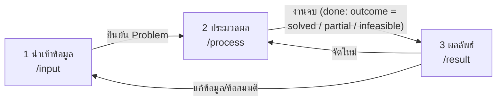

# 05 — Frontend 3 หน้า: ออกแบบหน้าที่และโครงสร้าง (ยังไม่มีโค้ด)

> ตกลงแล้ว: **เว็บ 3 หน้า** · หน้าที่แต่ละหน้าอ้างจาก `03_FRONTEND_ความต้องการ.md` (FR-xx) · เทคโนโลยี **React + Vite + TypeScript**
> อ่านคู่กับ `04_SYSTEM_ARCHITECTURE.md` (§5, §14–15) และ `AI_WEB_RULES_10B.md` (กฎโค้ด)
> ระดับของเอกสารนี้: ออกแบบ "หน้าไหนทำอะไร, ข้อมูลไหลอย่างไร, โครงไฟล์" — **ไม่เกี่ยวกับสี/ความสวย** · ผังหน้าจอเป็นแค่ตำแหน่งของหน้าที่ (wireframe ข้อความ)

---

## 1. ภาพรวม 3 หน้า

| หน้า | เส้นทาง | หน้าที่หลัก | ผลที่ส่งต่อให้หน้าถัดไป |
|---|---|---|---|
| **1. นำเข้าข้อมูล** | `/input` | ป้อน/ตรวจ/แก้ข้อมูลโจทย์ + ตั้งข้อสมมติ → ยืนยัน | `Problem` ที่ยืนยันแล้ว |
| **2. ประมวลผล** | `/process` | สั่งจัดตาราง · ดูความคืบหน้า · ยกเลิก · ดูกราฟค่าโทษ | `Schedule` + `Report` + ประวัติการจัด |
| **3. ผลลัพธ์** | `/result` | ดูตาราง 4 มุมมอง + หน้านักเรียน · รายงานการตรวจ/สาเหตุ · ส่งออก · สาธิต | — (ปลายทาง) |



**เส้นทางที่ไปได้:** 1→2→3 · กลับ 3→1 (แก้โจทย์) · 3→2 (จัดใหม่ด้วยค่าตั้งต้นอื่น) · 2→1 (ยกเลิกแล้วแก้ข้อมูล)
**ตัวกั้น (guard):** เข้า `/process` ไม่ได้ถ้ายังไม่มี `Problem` ที่ยืนยัน · เข้า `/result` ไม่ได้ถ้ายังไม่มีผล (ยกเว้นเปิดผลที่บันทึกไว้ / โหมดสาธิต) → พาไปหน้าที่ขาดพร้อมข้อความบอกเหตุผล

---

## 2. ส่วนที่ใช้ร่วมทุกหน้า (App Shell)

| ส่วน | หน้าที่ | FR |
|---|---|---|
| แถบนำทาง + ตัวบอกขั้น (1·2·3) | บอกว่าอยู่ขั้นไหน, ขั้นไหนพร้อม/ล็อก | — |
| ตัวบอกสถานะระบบ | เช็ค `/health`: เชื่อมต่อ Algorithm ได้ไหม, เวอร์ชัน contract | FR-80 |
| ป้ายโหมด | บอกชัดเมื่อเป็นโหมด **stub/สำรอง** (ไม่ใช่ผลจริง) | FR-82 |
| พื้นที่แจ้งเตือน | แสดง error ตามรหัส (`INVALID_INPUT`, `TIMEOUT`, `NETWORK` ฯลฯ) + ปุ่มลองใหม่ | FR-81 |
| ที่เก็บสถานะ + บันทึกในเครื่อง | รีเฟรชแล้วงานไม่หาย | FR-83 |
| บันทึกการกระทำสำคัญ (ทางเลือก) | นำเข้า/จัด/ส่งออกเมื่อไร ด้วยค่าตั้งต้นอะไร | FR-84 (C) |

---

## 3. หน้า 1 — นำเข้าข้อมูล (`/input`)

### 3.1 หน้าที่ (มาจาก FR)
| FR | ระดับ | ทำอะไรในหน้านี้ |
|---|---|---|
| FR-01 | M | อัปโหลด xlsx (ลาก-วาง/เลือกไฟล์) |
| FR-02 | M | แสดงข้อมูลที่ import: ชั้น/กลุ่ม · วิชา · ครู · ห้อง · เวลา (แท็บ/ส่วน) |
| FR-03 | M | แสดงคำเตือนจาก import ทีละข้อ ต้อง "รับทราบ" |
| FR-06 | M | ตั้งค่าข้อสมมติ/กฎ (นับกิจกรรมเป็นชม.ครู, ทฤษฎีรวมกลุ่ม, ขีดคาบต่อชั้น, ช่วงพัก ฯลฯ) |
| FR-09 | M | ยืนยันข้อมูล → ล็อก + สรุปจำนวน (วิชา/ชม./ครู/ห้อง) |
| FR-04, 05 | S | แก้/เพิ่ม/ลบ วิชา ครู ห้อง บนหน้าจอ |
| FR-07 | S | ใส่ข้อกำหนดเพิ่มจากกรรมการ |
| FR-08 | S | บันทึก/เปิดชุดโจทย์เป็นไฟล์ |
| FR-73 | S | ปุ่ม "โหลดข้อมูลตัวอย่าง" |

### 3.2 ผังตำแหน่ง (ข้อความ)
```
[ตัวบอกขั้น 1·2·3]                                   [สถานะระบบ]
┌ A. นำเข้าไฟล์ ─────────────────────────────────────────────┐
│  [ลาก-วางไฟล์ xlsx]  [โหลดข้อมูลตัวอย่าง]  [เปิดชุดโจทย์ที่บันทึก] │
└─────────────────────────────────────────────────────────────┘
┌ B. คำเตือนจากการนำเข้า (n ข้อ — รับทราบแล้ว x/n) ───────────┐
└─────────────────────────────────────────────────────────────┘
┌ C. ข้อมูลโจทย์ [แท็บ: กลุ่ม | วิชา | ครู | ห้อง | เวลา] (แก้ไขได้) ┐
└─────────────────────────────────────────────────────────────┘
┌ D. ข้อสมมติ/กฎ (ปรับค่าได้) ┐   ┌ E. สรุป + [ยืนยันและไปขั้นที่ 2] ┐
```

### 3.3 สถานะของหน้า
`ว่าง (ยังไม่มีข้อมูล)` → `กำลังอ่านไฟล์` → `มีข้อมูล (มี/ไม่มีคำเตือนค้าง)` → `ยืนยันแล้ว` · กรณีผิดพลาด: ไฟล์ไม่ใช่ xlsx / อ่านไม่ได้ (`INVALID_INPUT`) / อ่านบางส่วนได้ (`UNPARSEABLE_CELL` แสดงเป็นคำเตือน ไม่ใช่ล้ม)
**ปุ่มยืนยันกดได้เมื่อ:** มีข้อมูลครบ (≥ 1 กลุ่ม วิชา ครู ห้อง และเวลา) และคำเตือนระดับ "ต้องแก้" ถูกจัดการแล้ว

### 3.4 เรียก API (ผ่านชั้น api-client เท่านั้น)
`POST /v1/import` (ไฟล์) → `Problem` + `warnings[]` · `GET /health`
**ข้อมูลออก:** `Problem` (ยืนยันแล้ว) + ข้อสมมติ (`rules`) → ที่เก็บสถานะ + บันทึกในเครื่อง

### 3.5 เกณฑ์ผ่านของหน้า
- [ ] อัปโหลดไฟล์ตัวอย่างแล้วเห็นครบ 3 ชั้น และจำนวนตรงกับไฟล์ (เช่น ปวช.1 = 12 วิชา, ครู 5 คน) ทุกแท็บ
- [ ] คำเตือนทุกข้อแสดงและต้องรับทราบก่อนยืนยัน
- [ ] ไฟล์เสีย/ผิดชนิด → ข้อความไทยชัดเจน ไม่ crash
- [ ] เปลี่ยนข้อสมมติแล้วค่าถูกส่งไปกับ `Problem`
- [ ] รีเฟรชหน้าแล้วข้อมูลที่ป้อนยังอยู่
- [ ] จำนวนแถวไม่ตายตัว (ทดสอบด้วยข้อมูลเล็ก/ใหญ่กว่าตัวอย่าง)

---

## 4. หน้า 2 — ประมวลผล (`/process`)

### 4.1 หน้าที่
| FR | ระดับ | ทำอะไรในหน้านี้ |
|---|---|---|
| FR-10 | M | ปุ่มเริ่มจัดตารางอัตโนมัติ |
| FR-11 | M | แสดงสถานะ: รอคิว / กำลังจัด / เสร็จ / ล้มเหลว / ยกเลิก |
| FR-12 | M | **ความคืบหน้า + กราฟค่าความขัดแย้ง/ค่าโทษต่อรอบ** (หลักฐานข้อ 4.8) |
| FR-13 | S | ยกเลิกงาน |
| FR-14 | S | ตัวเลือกก่อนเริ่ม: งบเวลาสูงสุด, seed, น้ำหนักเป้าหมายคุณภาพ |
| FR-15 | S | ประวัติการจัดแต่ละครั้ง (ค่าตั้งต้น + ผล + คะแนนตรวจ) เทียบกันได้ |
| FR-16 | S | ตั้งชื่อ/เลือกผลที่จะใช้ |
| FR-81 | M | สถานะ โหลด/สำเร็จ/ผิดพลาดแยกตามรหัส |
| (ข้อเสนอ 5) | S | ตัวบอกความเป็นไปได้ล่วงหน้า (ชม.ที่ต้องการ vs ช่องที่มี) ก่อนกดเริ่ม |

### 4.2 ผังตำแหน่ง
```
[ตัวบอกขั้น 1·2·3]                                   [สถานะระบบ]
┌ A. สรุปโจทย์ที่จะจัด (อ่านอย่างเดียว) + [แก้ข้อมูล ← หน้า 1] ┐
┌ B. ตัวเลือก (งบเวลา · seed · น้ำหนัก)  [เริ่มจัดตาราง] [ยกเลิก] ┐
┌ C. สถานะงาน: ขั้นตอนปัจจุบัน (Plan → Act → Evaluate) + แถบความคืบหน้า + เวลาที่ใช้ ┐
┌ D. กราฟค่าโทษต่อรอบ (อัปเดตทุก ~1 วินาที)  ┐  ┌ E. ตัวเลขสด: ฝ่าฝืน Hard / ค่าโทษ / ครบคาบ % ┐
┌ F. ประวัติการจัด (ตาราง: ครั้งที่ · ค่าตั้งต้น · ผล · ค่าโทษ · [ใช้ผลนี้]) ┐
                                                       [ไปดูผลลัพธ์ →]
```

### 4.3 สถานะงาน (เครื่องสถานะของหน้า)
```
ยังไม่เริ่ม → กำลังส่งงาน → queued → running ─┬→ done · outcome = solved      (ผ่านกฎ Hard)     → [ไปหน้า 3]
                                              ├→ done · outcome = partial     (ยังมีการฝ่าฝืน)  → [ไปหน้า 3 พร้อมรายงาน]
                                              ├→ done · outcome = infeasible  (จัดไม่ได้)       → [ไปหน้า 3 ดูสาเหตุ]
                                              ├→ failed (ALGO_ERROR)          → แสดงข้อความ + ลองใหม่
                                              └→ cancelled                    → กลับเริ่มใหม่ได้
```
สถานะและ outcome ตรงกับ `02 §2.3` (แหล่งความจริง) · การจัดไม่ได้ **ไม่ใช่ความล้มเหลว** (ได้คะแนนข้อ 3.3)
กฎ: **งานจบแล้วไม่เด้งหน้าเอง** (ผู้ใช้กดไปต่อ) เพื่อให้กรรมการเห็นกราฟ · ปิดแท็บ/รีเฟรชระหว่างจัด → กลับมาดูงานเดิมได้ (เก็บ `jobId`)

### 4.4 เรียก API
`POST /v1/solve` → `jobId` · `GET /v1/jobs/{id}` (โพลทุก ~1 วินาที → สถานะ + ค่าโทษ + ประวัติ) · `POST /v1/jobs/{id}/cancel` · `GET /health`
**ข้อมูลเข้า:** `Problem` ที่ยืนยัน · **ข้อมูลออก:** `Schedule` + `Report` + ประวัติค่าโทษ (เก็บในที่เก็บสถานะ)

### 4.5 เกณฑ์ผ่านของหน้า
- [ ] กดเริ่มแล้วเห็นสถานะเปลี่ยนตามจริง (ทดสอบด้วย stub ที่ส่งความคืบหน้าจำลอง)
- [ ] กราฟอัปเดตต่อเนื่องและแสดงค่าโทษ **ลดลง** ตามข้อมูลที่ได้
- [ ] ยกเลิกแล้วสถานะเป็น "ยกเลิก" และเริ่มใหม่ได้
- [ ] ปิด/เปิดหน้าใหม่ระหว่างจัดแล้วยังตามงานต่อได้
- [ ] algorithm ล่ม/ตอบ error ผิดรูปแบบ → ข้อความชัด ไม่ค้าง ไม่ crash
- [ ] เกิน timeout ฝั่งโพล → แจ้งและให้ลองใหม่/ยกเลิก

---

## 5. หน้า 3 — ผลลัพธ์ (`/result`)

หน้านี้หนักที่สุด → แบ่งเป็น **แท็บภายในหน้า** (ยังนับเป็น 1 หน้า/1 เส้นทาง)

| แท็บ | หน้าที่ | FR |
|---|---|---|
| **ตารางสอน** | ตัวเลือกมุมมอง: กลุ่ม/นักเรียน · ครู · ห้อง · รายวิชา (+ ภาพรวม C) | FR-20–27, 30 (M: 20–24, 27) |
| **หน้านักเรียน** | เลือกชั้น/กลุ่ม → ตารางตนเอง อ่านง่าย (บนมือถือด้วย) | FR-28, 29 |
| **รายงาน/สาเหตุ** | ผล Validator ตามข้อคะแนน 1.1–2.4 · รายการฝ่าฝืนกดแล้วกระโดดไปดูในตาราง · สาเหตุเมื่อจัดไม่ได้ · เมตริก | FR-40–45 (M: 40–42, 44) |
| **ส่งออก** | Excel · PDF/พิมพ์ · รายงาน · ไฟล์ JSON สำรอง | FR-60–65 (M: 60, 61) |
| **สาธิต** | อธิบายเทคนิค Plan→Act→Evaluate · ข้อสมมติที่ใช้ · สคริปต์สาธิตทีละขั้น | FR-70–72 |
| **(ถ้ามีเวลา)** | แก้ด้วยมือ/ล็อกช่อง + ตรวจทันที | FR-50–52 (C) |

### 5.1 ผังตำแหน่ง
```
[ตัวบอกขั้น 1·2·3]                                   [สถานะระบบ]
┌ แถบสรุปผล: ผ่านกฎ Hard x/y · ค่าโทษ · ใช้ผลชุดที่ n ▼ · [ตรวจอีกครั้ง] [จัดใหม่ ← หน้า 2] [แก้โจทย์ ← หน้า 1] ┐
┌ แท็บ: ตารางสอน | หน้านักเรียน | รายงาน/สาเหตุ | ส่งออก | สาธิต ┐
│ (ตารางสอน) ตัวเลือก: [มุมมอง ▼] [กลุ่ม/ครู/ห้อง/วิชา ▼]  [ไฮไลต์ตามตัวกรอง]            │
│   กริด: แถว = คาบ 1–11 (มีแถวพักกลางวัน) · คอลัมน์ = จันทร์–ศุกร์                     │
│   คลิกช่อง → แผงรายละเอียด (รหัส ชื่อวิชา ครู ห้อง กลุ่ม ชั่วโมง)                       │
│ (ครู) เพิ่มสรุปภาระสอน: ชม.จริง vs เกณฑ์ตำแหน่ง ผ่าน/ไม่ผ่านพร้อมข้อความ                   │
```

### 5.2 สถานะของหน้า
`มีผลครบ` · `มีผลแต่ยังฝ่าฝืน (แสดงตำแหน่งที่ชน)` · `จัดไม่ได้ (แสดงสาเหตุแทนตาราง)` · `ไม่มีผล (guard พากลับหน้า 2)` · `โหมดสำรอง/สาธิต (มีป้ายชัดเจน)`

### 5.3 เรียก API
`POST /v1/validate` (ตรวจซ้ำตามกดเอง/หลังแก้ด้วยมือ) · `GET /health` · ที่เหลือคำนวณฝั่ง FE จาก `Schedule` ที่มีอยู่ (view-model, export)

### 5.4 เกณฑ์ผ่านของหน้า
- [ ] ทุกมุมมองมาจาก `Schedule` ชุดเดียวกัน (ข้อมูลตรงกันข้ามมุมมอง)
- [ ] แสดงถูกต้อง: คาบคร่อม 2–5 ชั่วโมง, 2 กลุ่มเรียนพร้อมกันคนละวิชา, ทฤษฎีรวมกลุ่ม, แถวพักกลางวัน, วัน-คาบที่ไม่มีเรียน
- [ ] ครู: ภาระสอนรวมถูก และผ่าน/ไม่ผ่านดูออกด้วยข้อความ (ไม่ใช้สีอย่างเดียว)
- [ ] รายงาน: ทุกข้อ 1.1–2.4 มีผลและกดจากการฝ่าฝืนไปดูตำแหน่งในตารางได้
- [ ] จัดไม่ได้ → เห็นสาเหตุเป็นข้อๆ อ่านเข้าใจ
- [ ] Export Excel/PDF เปิดได้ ภาษาไทยไม่เพี้ยน ข้อมูลตรงหน้าจอ (ทดสอบบนเครื่องอื่น)
- [ ] หน้านักเรียนอ่านได้บนจอแคบ

---

## 6. ข้อมูลไหลระหว่างหน้า (ที่เก็บสถานะ)

| ข้อมูล | สร้างที่ | ใช้ที่ | เก็บถาวรในเครื่อง |
|---|---|---|---|
| `problemDraft` (ร่างที่แก้อยู่) | หน้า 1 | หน้า 1 | ✅ |
| `problem` (ยืนยันแล้ว) + `rules` | หน้า 1 | หน้า 2, 3 | ✅ |
| `importWarnings` + สถานะรับทราบ | หน้า 1 | หน้า 1 | ✅ |
| `solveOptions` | หน้า 2 | หน้า 2 | ✅ |
| `currentJob` (`jobId`, สถานะ) | หน้า 2 | หน้า 2 | ✅ (ตามงานต่อหลังรีเฟรช) |
| `penaltyHistory` | หน้า 2 (โพล) | หน้า 2, 3 (สาธิต) | ✅ |
| `runs[]` (ประวัติ: ตัวเลือก + `Schedule` + `Report`) | หน้า 2 | หน้า 2, 3 | ✅ (จำกัดจำนวน) |
| `selectedRunId` | หน้า 2/3 | หน้า 3 | ✅ |
| `viewFilters` (มุมมอง/ตัวกรอง) | หน้า 3 | หน้า 3 | ไม่จำเป็น |

หมายเหตุ: ที่เก็บในเครื่องอาจใช้ไม่ได้ (โหมดส่วนตัว/เต็ม) → ห่อด้วย try/catch ให้แอปทำงานต่อโดยไม่บันทึก

---

## 7. โครงโค้ด (ตามกฎ `AI_WEB_RULES_10B` และ `04 §15.3`)

> พาธเต็มคือ `frontend/src/...` (แอปอยู่ในโฟลเดอร์ `frontend/` ของ repo `timetable-maker-Frontend`) · `contract/` อยู่ที่ `frontend/contract/` ข้างๆ `src/`

```
src/
  app/
    AppShell.tsx            # โครงหน้า + ตัวบอกสถานะระบบ
    routes.tsx              # รวมเส้นทาง
    guards.ts               # ตัวกั้นเส้นทาง
  pages/
    InputPage.tsx           # ประกอบ component ของหน้า 1 (บาง)
    ProcessPage.tsx         # หน้า 2
    ResultPage.tsx          # หน้า 3
  features/
    import-data/            # components: UploadBox, WarningList, DataTabs(Groups/Courses/Teachers/Rooms/Time), RulesForm, ConfirmSummary
                            # hooks: useImportFile, useProblemDraft · logic: validate-draft · schema.ts
    solve/                  # components: ProblemSummary, SolveOptionsForm, JobStatusPanel, PenaltyChart, LiveMetrics, RunHistory, FeasibilityHint
                            # hooks: useSolveJob (โพล+ยกเลิก+กู้คืนหลังรีเฟรช)
    schedule-view/          # components: ViewSwitcher, ScheduleGrid, ScheduleCell, CellDetail, TeacherLoadSummary, StudentView
                            # logic: build-grid-by-group / -teacher / -room / -course (ฟังก์ชันบริสุทธิ์)
    report/                 # components: RubricSummary, ViolationList, InfeasibilityList, MetricsPanel · logic: group-violations
    export/                 # excel/ pdf/ (ใช้ view-model เดียวกับหน้าจอ)
    demo/                   # TechniqueExplainer, AssumptionsPanel, DemoScript
  lib/
    api-client/             # จุดเดียวที่เรียกเครือข่าย (http | stub) + รหัสข้อผิดพลาด
    persistence/            # เก็บ/อ่านในเครื่อง (try/catch)
  state/                    # ที่เก็บสถานะ (§6)
  components/ui/            # ปุ่ม แท็บ ตาราง กล่องแจ้งเตือน (ไม่มีตรรกะธุรกิจ)
  config/                   # env, routes, texts (ข้อความไทยทั้งหมด), constants (ชื่อวัน ฯลฯ)
  styles/tokens
# (นอก src/) frontend/contract/  # สำเนาจาก ai-contract (v0.2+)
```
ทุกไฟล์ ≤ 200 บรรทัด · หน้า (`*Page.tsx`) มีแต่การประกอบ · ไม่มี hard-code (ข้อความ/ค่า/ชื่อวิชา) · เรียกเครือข่ายผ่าน `api-client` เท่านั้น

---

## 8. แผนลงมือ
รายการงาน `W0…W12` (ขนาด XS–M, เกณฑ์ผ่าน, ไฟล์ที่แตะ) อยู่ที่ **`06_DEVELOPMENT_PLAN_Frontend.md` §5** — ไม่เก็บซ้ำที่นี่ · ตาราง FR → หน้า → งานอยู่ที่ `06 §6`
หลักการ: ทำด้วย stub (อ่านข้อมูลตัวอย่างจาก contract) ก่อน — **ไม่ต้องรอ algorithm ของเพื่อน** · Prerequisite D1 (contract v0.2 + fixtures F1–F4) ดู `06 §3`

**ทำไมเริ่มจากหน้า 3:** การแสดงตารางที่ซับซ้อนที่สุดอยู่หน้านี้ และใช้ผลเฉลยตัวอย่างได้เลยโดยไม่ต้องรอ import/solver → ถ้ารูปทรงข้อมูลไม่พอ จะรู้ตั้งแต่ต้นและแก้ contract ได้ทัน

---

## 9. ความเสี่ยงและสิ่งที่ยังไม่ตัดสิน

| เรื่อง | ผลกระทบ | แนวทาง |
|---|---|---|
| contract ยังเป็น placeholder | หน้า 1–3 ไม่มีชนิดข้อมูลจริง | ทำ v0.2 + fixtures ก่อน W3a (Prerequisite D1 — `06 §3`) |
| หน้า 3 มีแท็บเยอะ | งานบวม | ทำแท็บ M ก่อน (ตารางสอน, รายงาน, ส่งออก) · แท็บสาธิต/แก้ด้วยมือทีหลัง |
| ภาษาไทยใน PDF | เสี่ยงสูง | spike S1 ก่อน W9 · แผนสำรองให้ BE สร้าง PDF |
| โจทย์กรรมการต่างจากตัวอย่าง (หน้า 1) | | FR-04/05/07 + ข้อสมมติเป็นข้อมูล · ทดสอบด้วย F4 |
| คำถาม FQ2 (กรรมการให้แก้ตารางด้วยมือไหม) | ถ้าใช่ W12 ต้องยกขึ้นเป็นงานหลัก | ถามผู้จัด |
| คำถาม FQ4 (หน้านักเรียนต้องเปิดจากเครื่องอื่นไหม) | ถ้าใช่ ต้องเปิดเครือข่ายเครื่อง | ถามผู้จัด |

**ข้อสมมติของเอกสารนี้:** 3 หน้า = นำเข้า / ประมวลผล / ผลลัพธ์ ตามที่คุณระบุ · หน้า 3 ใช้แท็บเพื่อรวมรายงาน ส่งออก และสาธิตไว้ใน 1 เส้นทาง (ถ้าอยากแยกเป็นหน้าเต็มบอกได้) · ยังไม่ได้ตรวจเลขจำนวนวิชาในเกณฑ์ §3.5 กับไฟล์ xlsx ซ้ำ (ปวช.1 มี 12 วิชา: สามัญ 5 + แผนก 7 รวมกิจกรรม)
